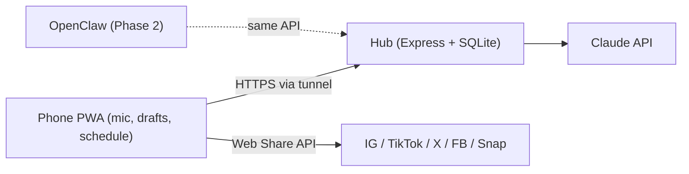

# Brand Studio

**Speak on your phone. Post everywhere.**

Say an idea out loud and Brand Studio turns it into ready-to-post, platform-native content for X, Facebook, TikTok, Snapchat, Instagram and LinkedIn — written in your voice, not generic marketing speak. It also keeps your content week on rails: a daily schedule, a content publish queue, insights, and a bring-your-own-agent API (Studio).

**Category claim:** the biggest social publishing surface with no social network — Uber for rides without cars; Brand Studio for posts without owning Instagram.

It has two parts:

- **`hub/`** - a small always-on server (Node + Express + SQLite) that is the single source of truth (your goals, ideas, drafts, schedule, workouts) and talks to Claude. Runs on your 24/7 machine.
- **`app/`** - the installable phone app (React PWA). Talks to the hub over HTTPS.

This split is deliberate: later, an **OpenClaw agent** can plug into the exact same hub data to work in the background (see [Phase 2](#phase-2-openclaw-agent-add-on)).



---

## 1. Set up the hub (on your always-on machine)

Requires Node.js 20.6+.

```bash
cd hub
npm install
cp .env.example .env
```

Edit `.env`:

- `ANTHROPIC_API_KEY` - get one at https://console.anthropic.com/ (pay-as-you-go, usually pennies per draft).
- `HUB_TOKEN` - a long random secret. Generate one with `openssl rand -hex 24`.
- `ALLOWED_ORIGINS` - add your app URL later (e.g. `https://your-app.vercel.app`); keep `http://localhost:5173` for local dev.

Start it:

```bash
npm start
# Brand hub listening on http://localhost:8787
```

To keep it running 24/7, use `pm2` (`npm i -g pm2 && pm2 start "npm start" --name brand-hub`) or a systemd service.

## 2. Expose the hub over HTTPS (so your phone can reach it anywhere)

The phone needs a stable HTTPS URL. Easiest is a **Cloudflare Tunnel**:

```bash
# one-time: install cloudflared, then
cloudflared tunnel --url http://localhost:8787
# prints a https://<random>.trycloudflare.com URL -> use it as your Hub URL
```

For a permanent URL, set up a named tunnel on a domain, or use **Tailscale Funnel** as an alternative. Add the resulting HTTPS origin to `ALLOWED_ORIGINS` in `hub/.env` and restart the hub.

## 3. Run / deploy the app

Local dev:

```bash
cd app
npm install
npm run dev
# open http://localhost:5173
```

Deploy the PWA (recommended: Vercel free tier):

```bash
npm run build      # outputs dist/
# Deploy the app/ folder to Vercel (framework preset: Vite). No env vars required
# because you enter the hub URL + token in the app's Setup screen.
```

HTTPS hosting is required for the microphone and for "install to home screen".

## 4. First run on your phone

1. Open the deployed app in **Chrome on Android** (or **Safari on iPhone**).
2. Menu (three dots) -> **Add to Home screen** (iPhone: Share -> **Add to Home Screen**). It now runs full-screen like a native app.
3. Pair with the hub — no typing needed:

```bash
cd hub
npm run qr -- https://your-tunnel.trycloudflare.com   # prints a QR code
```

   In the app tap **Scan setup code** and point the camera at your terminal. (Manual entry of Hub URL + token still works in Setup.)
4. Fill in **Your brand brain** (goals, projects, brand voice). Every draft uses this.
5. Go to **Capture**, tap the mic, talk, then **Draft now**.

## 5. Publish to Google Play (TWA)

The PWA can be wrapped as a Trusted Web Activity — a thin native shell that ships the same app through the Play Store.

1. Make sure the app is deployed on a stable HTTPS domain (your Vercel URL).
2. Go to [pwabuilder.com](https://www.pwabuilder.com), enter the app URL, and download the generated **Android package** (it reads the manifest — icons and settings are already compliant).
3. Create a [Play Console](https://play.google.com/console) account ($25 one-time) and upload the `.aab`.
4. PWABuilder gives you an `assetlinks.json` with your signing fingerprint. Serve it at `https://your-app-domain/.well-known/assetlinks.json` (drop it in `app/public/.well-known/`, redeploy) — this removes the browser bar so it looks fully native.
5. Fill in the store listing (icon and screenshots from the app) and submit for review.

Updates after release are free: the TWA loads the live web app, so deploying to Vercel updates the "native" app instantly.

---

## Using it

- **Capture** - tap the mic and talk (or type). Save to the idea backlog, or "Draft now" to generate posts. First launch shows a 4-step tour (replayable from Setup).
- **Drafts** - each idea becomes 5 platform-native posts. **Copy**, **Share**, **Post** directly, or **Schedule** for later. Agent drafts wait for your Approve.
- **Today** - your weekly schedule with checkable, fully editable time blocks (tap to edit, + to add) and a **Posts** view showing the scheduled-post queue with status dots.
- **Workout** - log a session (typed or spoken, any date), edit in place, keep a streak, and "Turn into content".
- **Setup** - account + plan, brand brain (free text + structured traits), connected platforms, agents, invites.
- **Insights** (linked from Capture) - per-platform content-gap playbook + a research feed your agent fills weekly.

The default weekly rhythm (edit in `hub/src/db.js` seed, or via the API):

- Mon / Thu: son days (light engagement + capture); Thu 7-10pm meetup.
- Tue / Wed / Fri: production days - protected deep-dev block first, then content, plus recorded workouts.
- Sat / Sun: family-flex.

---

## Hosted mode (the product)

The hub also runs as a multi-tenant service (currently at `https://brand-studio-hub.fly.dev`, deployed from `hub/` with `fly deploy`). Users create an account in the app (email + password) and never see a server. **Self-hosted server pairing is a Studio-plan unlock** (Setup → Studio tools).

- Per-user data isolation, session tokens, login rate limiting.
- Fly secrets: `ANTHROPIC_API_KEY`, `HUB_TOKEN` (owner/agent access). Env: see `hub/fly.toml`.

### Tiers & billing

| Tier | Price | Drafts / month | Extras |
| --- | --- | --- | --- |
| Free | $0 | 10 | Share-sheet posting |
| Creator | $19/mo | 200 | Direct Post + content schedule |
| Studio | $49/mo | 1000 | Agents, insights push, **self-hosted hub** |

Stripe Checkout + Customer Portal when secrets are set (`STRIPE_SECRET_KEY`, `STRIPE_WEBHOOK_SECRET`, `STRIPE_PRICE_CREATOR`, `STRIPE_PRICE_STUDIO`, `APP_ORIGIN`). Until then, Setup falls back to mailto upgrade; `npm run set-tier` still works for ops.

Referral bonuses (+20 drafts each side, `?ref=CODE` from Setup → Invite) stack on top of the monthly cap.

Pitch / market pack: [`docs/pitch/`](docs/pitch/).

```bash
cd hub
npm run set-tier -- user@email.com creator
```

## Sharing & posting

**Guided multi-Share (all plans):** From Drafts, **Share** walks through selected platforms step-by-step using the phone share sheet (caption copied each step). No vendor COGS.

**One-tap Post (Studio):** Linked-account publish for Instagram / Facebook / TikTok / LinkedIn via the unified publisher (`UNIFIED_API_KEY`). Gated to Studio for margin until direct platform APIs replace it. Never expose the vendor name in the app UI.

| Platform | Status | To enable |
| --- | --- | --- |
| All (Share) | Guided multi-Share | Works without linking |
| X | Direct Post (Creator+) | OAuth at [developer.x.com](https://developer.x.com); callback `…/api/connect/x/callback`; secrets `X_CLIENT_ID` + `X_CLIENT_SECRET` |
| Instagram / Facebook / TikTok / LinkedIn | Direct Post (Studio) | Set `UNIFIED_API_KEY`. Swap driver in `hub/src/social.js` for direct APIs later. |
| Snapchat | Share sheet only | No public posting API |

### Scheduled posts

Content queue auto-publish uses the same tier rules as Post (Studio for unified platforms, Creator+ for X). Daily plan works on all signed-in plans.

## Agent API (bring your own agent)

Create an API key on the **Agents** page (Setup → Manage agents), then call the same REST API the app uses. The page also has copy-paste setup instructions to feed straight into your agent.

```bash
HUB=https://brand-studio-hub.fly.dev
KEY=ak_...   # from the Agents page (Studio tier)

curl -H "Authorization: Bearer $KEY" $HUB/api/ideas            # read the idea backlog
curl -H "Authorization: Bearer $KEY" $HUB/api/profile          # brand voice + traits for SOUL.md
curl -X POST -H "Authorization: Bearer $KEY" -H "Content-Type: application/json" \
  -d '{"topic":"...","variants":{"x":"...","facebook":"...","tiktok":"...","snapchat":"...","instagram":"..."}}' \
  $HUB/api/drafts                                              # push a draft (lands in the approval queue)
curl -X POST -H "Authorization: Bearer $KEY" -H "Content-Type: application/json" \
  -d '{"platform":"tiktok","title":"Gap: beginner meal prep","body":"High search volume, few quality videos this week."}' \
  $HUB/api/insights                                            # push research into the Insights feed
```

Media: `POST /api/media` (raw image/video body) returns a public URL you can set as `media_url` on ideas and drafts.

For OpenClaw: generate its `SOUL.md` from `GET /api/profile`, poll `GET /api/ideas` for open ideas, push results to `POST /api/drafts` and weekly research to `POST /api/insights`, and run it on `cron`.

### Agent security model

Agent keys are deliberately weaker than your login. They act on your **content only**:

| | Agent key (`ak_…`) can | Agent key can NOT |
| --- | --- | --- |
| Read | profile, ideas, drafts, schedule, workouts, insights | posts history, connections, other users' anything |
| Write | create ideas/drafts (forced into the approval queue as `source='agent'`), generate, upload media, post insights, edit draft text | **approve drafts** (`status` locked to `draft`), publish or schedule posts, edit profile/schedule/workouts |
| Admin | — | create/revoke keys, manage connections, export data, any `/api/auth/*` |

Additional protections: every agent request is written to an `agent_events` audit log (visible as "Recent activity" on the Agents page), and each key is rate-limited (`AGENT_RATE_LIMIT`, default 60 req/min). Revoking a key on the Agents page locks the agent out instantly. A leaked agent key can spend your draft quota and read your content — it can never post publicly, take over the account, or touch the server.

---

## Notes

- Voice uses the browser's Web Speech API - works in Chrome on Android and Safari on iOS 14.5+ (iPhone users need Settings → Siri & Search → Dictation turned on; recognition runs through Apple's dictation engine).
- iPhone install: open the app in Safari → Share → "Add to Home Screen". Full iOS PWA support is wired in (apple-touch-icon, standalone mode, translucent status bar, notch-safe layout). The Android-only bits — QR pairing scanner and receiving shares FROM other apps — hide themselves gracefully on iOS; sharing OUT via the share sheet works everywhere.
- Hosted data lives on the Fly volume (`/data/hub.db`); self-hosted data lives in `hub/data/hub.db`. Back those up to keep your content.
- Other apps can share text/links INTO Brand Studio (share sheet -> Brand Studio) thanks to the PWA share target; it lands in Capture ready to draft.
